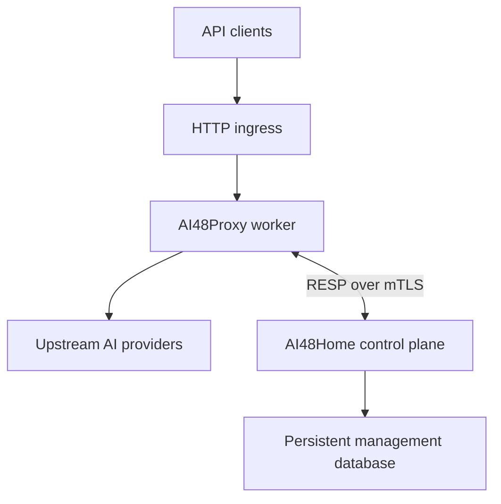

# AI48Proxy

Licensed under the [MIT License](LICENSE).

An asynchronous AI gateway written in Rust and Tokio, designed to run as an
**AI48Home-managed worker**. AI48Home controls credentials, model access, routing
and cluster policy; AI48Proxy executes selected upstream requests and reports
usage and execution state back to the control plane.

## Architecture



AI48Proxy does not maintain a separate credential catalog or provide a standalone
management service. Provider selection and authorization remain with AI48Home.
Each worker has a private identity, an isolated membership lifetime and a durable
usage outbox.

## Capabilities

- OpenAI-style Chat Completions and Responses, Claude Messages, and Gemini
  generation APIs, with supported cross-format request and response translation.
- OpenAI-compatible custom upstreams, Codex, Claude, Gemini, Vertex,
  Antigravity, xAI, Kimi (including `kimi-ai`) and Meta text execution using
  Home-selected credentials, within provider-specific format/tool restrictions.
- Incremental SSE translation, bounded WebSocket sessions and cancellation-aware
  execution accounting.
- Image generation/editing for supported providers, xAI image completion SSE,
  xAI speech, and JSON-based xAI video jobs with an OpenAI-style video facade
  and Home-KV credential-bound retrieval.
- Home configuration subscriptions, immutable configuration snapshots, payload
  rules, request-scoped error actions, supported reasoning controls, pre-header
  SSE keepalives and response-header filtering. Codex HTTP cache identity is
  prepared before payload rules.
- Certificate enrollment, verified mTLS, heartbeat fencing, cluster discovery,
  reconnect recovery, conditional membership takeover and planned rebalance that
  preserves active executions on their origin Home. Negotiated latency telemetry
  and randomized equal-load node selection are wired.
- Cumulative concurrency releases, in-flight snapshots and durable accepted usage
  reporting, including supported image dimensions and optional `media_counts`.
- Bounded Home application-log forwarding and opt-in sanitized request metadata
  logs submitted once at generation response-body completion, error or disconnect
  (499), with the selected provider label. Bodies and credential headers are omitted.

Support depends on the selected provider, credential type, request format and
configuration. A registered route is not a promise that every combination works.
See the [provider guide](docs/provider.md) and
[implementation status](docs/porting-status.md) for boundaries.

## Deployment

The included stack consists of PostgreSQL, AI48Home, three AI48Proxy workers and
nginx. Worker containers use the published multi-architecture image
`ghcr.io/sofyan48/ai48proxy`; the installer pulls it, generates private
configuration, initializes a fresh database once, provisions distinct worker
tokens and starts services in readiness order.

Download or run the installer from the AI48Proxy repository root:

```sh
curl -fsSLO https://raw.githubusercontent.com/sofyan48/AI48Proxy/main/install.sh
chmod +x install.sh
./install.sh init       # create the local .env and deployment files
./install.sh deploy    # pull GHCR worker images and start the production stack
./install.sh status
./install.sh logs ai48proxy-1
```

Useful lifecycle commands:

```sh
./install.sh start
./install.sh stop
```

`deploy` is the production-style three-worker stack with AI48Home, PostgreSQL,
and Nginx. It pulls images; it does not build the worker locally. For source
reload during development, use [Development Docker Compose](#development-docker-compose)
instead. Run it from the repository root so the generated `deploy/` files and
Compose configuration remain together.

The installer does not build the worker image locally. Set `AI48PROXY_IMAGE` in
`.env` to pin a release, for example `ghcr.io/sofyan48/ai48proxy:v0.1.0`.
Images are published by GitHub Actions for `v*` tags; see
[image publishing](docs/docker.md#publish-the-worker-image).

- AI48Home management: port `8327`.
- Client API ingress: port `8317`.
- Service network: `ai48proxy-network`.

Keep `.env`, generated deployment YAML, enrollment tokens and identity volumes
private. Do not run another stack on the same published ports. Existing databases
and worker identities require an explicit migration, not reinitialization.

See the [Docker deployment guide](docs/docker.md) for configuration, persistence,
service naming changes and operational precautions.

## Development Docker Compose

`docker-compose.dev.yml` is a local-source single-worker development stack. It
uses `cargo-watch` to rebuild and restart the worker process from this checkout
and does not affect the production Compose or GHCR workflow. Create a local Home enrollment token at `home.jwt` (ignored by
git), then run:

```sh
./install.sh init  # only if you need the generated Home config
# or use an existing AI48Home development instance on localhost:8327
docker compose -f docker-compose.dev.yml up --build
```

The first command builds the development toolchain image. After that, source
changes are handled by `cargo watch`; do not rebuild the image for every edit.
Use `docker compose -f docker-compose.dev.yml build` only when changing the
Rust toolchain or development Dockerfile.

The worker API is available at `http://localhost:8317`. Override the Home port,
worker port, or token path with `HOME_PORT`, `AI48PROXY_PORT`, and
`HOME_JWT_FILE`. Enrollment tokens are one-shot; use a new token and remove the
local `.ai48proxy` state when re-enrolling.

## Build and verify

```sh
cargo build --locked
cargo test --locked --all-targets
cargo clippy --locked --all-targets -- -D warnings
cargo fmt --all --check
```

`Cargo.lock` pins dependency resolution. Automated fixtures use synthetic
credentials and loopback upstreams; they do not establish live-provider acceptance.

## Run a worker

Provision an enrollment token in AI48Home using
`POST /v8/management/certificates/clients`. Prefer a protected token file rather
than placing a token in command arguments:

```sh
cargo run --locked -- \
  --identity-dir .ai48proxy \
  --home-jwt-file /secure/path/worker.jwt
```

`HOME_JWT_FILE` and `HOME_JWT` are also supported. Never share one worker identity
between concurrently running processes.

**Enrollment security:** the initial enrollment exchange sends its one-time
secret over plaintext RESP. CA fingerprint verification does not encrypt that
exchange. Use an operator-protected network path or tunnel. Subsequent Home
connections use verified mTLS. The provisioning token is treated as a trusted
capability; its signature is not locally verified.

For an already enrolled identity:

```sh
cargo run --locked -- \
  --identity-dir .ai48proxy \
  --home-host 127.0.0.1 \
  --home-port 8327
```

Listener settings come from Home; port `8317` is used when absent. Validate a
saved downstream configuration without starting the worker:

```sh
cargo run --locked -- --check-config home-snapshot.yaml
```

## API surface

| Route | Purpose |
| --- | --- |
| `GET /healthz` | Membership readiness; returns 503 when unavailable |
| `GET /v1/models` | Home-authorized model catalog |
| `POST /v1/chat/completions` | Chat execution and supported provider bridges |
| `POST /v1/completions` | Compatible text completions |
| `POST /v1/responses` | Responses execution or compatible Chat bridge |
| `GET /v1/responses` | Responses WebSocket sessions |
| `POST /v1/responses/compact` | Supported compact execution |
| `POST /v1/messages` | Claude Messages and supported Chat translation |
| `POST /v1/messages/count_tokens` | Supported native Claude token estimates |
| `POST /v1beta/models/{model}:generateContent` | Google-format generation |
| `POST /v1beta/models/{model}:streamGenerateContent` | Google-format SSE generation |
| `POST /v1/images/generations` | Supported image generation |
| `POST /v1/images/edits` | Supported image editing, including multipart input |
| `POST /v1/audio/speech`, `POST /v1/tts` | Supported xAI speech execution |
| `POST /v1/videos`, `POST /v1/videos/generations` | xAI video generation |
| `POST /v1/videos/edits`, `POST /v1/videos/extensions` | xAI video editing/extension |
| `GET /v1/videos/{request_id}` | Credential-bound xAI video retrieval |
| `POST /openai/v1/videos`, `GET /openai/v1/videos/{video_id}` | OpenAI-style facade over xAI video jobs |
| `GET /openai/v1/videos/{video_id}/content` | Video download without forwarding authorization |

Video creation accepts JSON and multipart form input for reference media. Retrieval requires an
unexpired Home-KV credential binding (`video-result-auth-cache-ttl`, default `3h`).
Upstream errors are sanitized because provider messages can contain sensitive information.

## Operational limits

- Native plugin execution and Gemini CLI are unavailable; Home snapshots with `plugins.enabled: true` are rejected during worker registration.
  Devin is intentionally out of scope and is not supported.
- Native WebSocket proxy transport, overlapping turns, advanced steering, xAI
  WebSockets, advanced Claude/Antigravity signed replay and complete provider-specific
  schema behavior remain unimplemented or limited.
- xAI, Kimi and Meta still reject unsupported source formats, advanced replay and
  continuation/compaction. Meta DCA credentials are refreshed through Home before use.
  Native plugin execution remains unavailable. See the provider guide for exact subsets.
- Video is xAI-only; compatible/Codex image SSE is available only when the upstream returns a validated SSE stream.
- Planned rebalance moves only the replacement connection, not active execution
  ownership. Releases and usage remain origin-bound during the process lifetime;
  failures roll back to the origin. Restart usage replay uses the current Home,
  because origin routing is not persisted.
- Unsupported active execution settings are rejected rather than silently ignored.
- Durable reporting protects accepted events, not usage never observed before a
  crash. Capacity or persistence failures can fence admission.
- Shutdown is bounded. Outstanding execution/accounting ownership must be
  reconciled before reusing an identity or promoting a deployment.

Complete the [worker acceptance runbook](docs/worker-acceptance.md) for your actual
Home configuration and upstream providers before production rollout.

## Documentation

- [AI48Home integration](docs/home-compatibility.md)
- [Provider guide](docs/provider.md)
- [Codex and OpenAI-compatible execution](docs/codex-openai-parity.md)
- [Claude request and rate-limit handling](docs/claude_limits_wiring.md)
- [Docker deployment](docs/docker.md)
- [Implementation status](docs/porting-status.md)
- [Worker acceptance](docs/worker-acceptance.md)

## Compatibility references and attribution

AI48Proxy integrates with [AI48Home](https://github.com/sofyan48/AI48Home).
[CLIProxyAPI](https://github.com/router-for-me/CLIProxyAPI) has been used as an
interoperability reference, and portions of the provider behavior and algorithms
were adapted from its implementation. This acknowledgment does not imply
endorsement, affiliation, a clean-room implementation, or complete compatibility.
Applicable third-party copyright notices and license obligations must be preserved
when distributing derived material. Provider and protocol names identify the
services and interfaces supported by the gateway.
