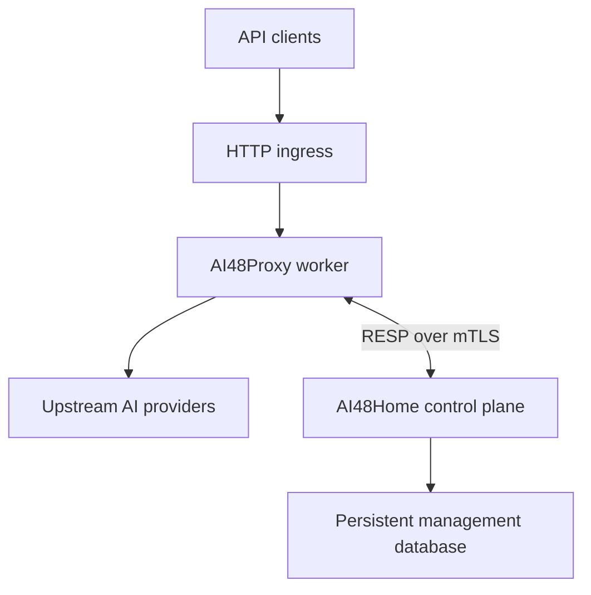

# AI48Proxy

An asynchronous AI gateway written in Rust and Tokio, designed to run as an
**AI48Home-managed worker**. AI48Home controls credentials, model access, routing
and cluster policy; AI48Proxy executes selected upstream requests and reports
usage and execution state back to the control plane.

## Architecture



AI48Proxy does not maintain a separate credential catalog or provide a standalone
management service. Provider selection and authorization remain with AI48Home.
Each worker has a private identity, an isolated membership lifetime and a durable
usage outbox.

## Capabilities

- OpenAI-style Chat Completions and Responses, Claude Messages, and Gemini
  generation APIs, with supported cross-format request and response translation.
- OpenAI-compatible custom upstreams, Codex, Claude, Gemini, Vertex and
  Antigravity execution using Home-selected credentials.
- Incremental SSE translation, bounded WebSocket sessions and cancellation-aware
  execution accounting.
- Image generation/editing for supported providers and xAI speech endpoints.
- Home configuration subscriptions, immutable configuration snapshots, payload
  rules, supported reasoning controls, keepalives and response-header filtering.
- Certificate enrollment, verified mTLS, heartbeat fencing, cluster discovery,
  reconnect recovery, conditional membership takeover and drained-worker rebalance.
- Cumulative concurrency releases, in-flight snapshots and durable accepted usage
  reporting, including supported image dimensions.
- Bounded Home application-log forwarding and opt-in sanitized request metadata
  logs. Request/response bodies and credential headers are omitted.

Support depends on the selected provider, credential type, request format and
configuration. A registered route is not a promise that every combination works.
See the [provider guide](docs/provider.md) and
[implementation status](docs/porting-status.md) for boundaries.

## Deployment

The included stack consists of PostgreSQL, AI48Home, three AI48Proxy workers and
nginx. The installer generates private configuration, initializes a fresh database
once, provisions distinct worker tokens and starts services in readiness order.

```sh
./install.sh init
./install.sh deploy
./install.sh status
./install.sh logs ai48proxy-1
```

- AI48Home management: port `8327`.
- Client API ingress: port `8317`.
- Service network: `ai48proxy-network`.

Keep `.env`, generated deployment YAML, enrollment tokens and identity volumes
private. Do not run another stack on the same published ports. Existing databases
and worker identities require an explicit migration, not reinitialization.

See the [Docker deployment guide](docs/docker.md) for configuration, persistence,
service naming changes and operational precautions.

## Build and verify

```sh
cargo build --locked
cargo test --locked --all-targets
cargo clippy --locked --all-targets -- -D warnings
cargo fmt --all --check
```

`Cargo.lock` pins dependency resolution. Automated fixtures use synthetic
credentials and loopback upstreams; they do not establish live-provider acceptance.

## Run a worker

Provision an enrollment token in AI48Home using
`POST /v8/management/certificates/clients`. Prefer a protected token file rather
than placing a token in command arguments:

```sh
cargo run --locked -- \
  --identity-dir .ai48proxy \
  --home-jwt-file /secure/path/worker.jwt
```

`HOME_JWT_FILE` and `HOME_JWT` are also supported. Never share one worker identity
between concurrently running processes.

**Enrollment security:** the initial enrollment exchange sends its one-time
secret over plaintext RESP. CA fingerprint verification does not encrypt that
exchange. Use an operator-protected network path or tunnel. Subsequent Home
connections use verified mTLS. The provisioning token is treated as a trusted
capability; its signature is not locally verified.

For an already enrolled identity:

```sh
cargo run --locked -- \
  --identity-dir .ai48proxy \
  --home-host 127.0.0.1 \
  --home-port 8327
```

Listener settings come from Home; port `8317` is used when absent. Validate a
saved downstream configuration without starting the worker:

```sh
cargo run --locked -- --check-config home-snapshot.yaml
```

## API surface

| Route | Purpose |
| --- | --- |
| `GET /healthz` | Membership readiness; returns 503 when unavailable |
| `GET /v1/models` | Home-authorized model catalog |
| `POST /v1/chat/completions` | Chat execution and supported provider bridges |
| `POST /v1/completions` | Compatible text completions |
| `POST /v1/responses` | Responses execution or compatible Chat bridge |
| `GET /v1/responses` | Responses WebSocket sessions |
| `POST /v1/responses/compact` | Supported compact execution |
| `POST /v1/messages` | Claude Messages and supported Chat translation |
| `POST /v1/messages/count_tokens` | Supported native Claude token estimates |
| `POST /v1beta/models/{model}:generateContent` | Google-format generation |
| `POST /v1beta/models/{model}:streamGenerateContent` | Google-format SSE generation |
| `POST /v1/images/generations` | Supported image generation |
| `POST /v1/images/edits` | Supported image editing, including multipart input |
| `POST /v1/audio/speech`, `POST /v1/tts` | Supported xAI speech execution |

Video routes currently return explicit unsupported-capability errors. Upstream
errors are sanitized because provider messages can contain sensitive information.

## Operational limits

- Native plugin execution, Gemini CLI, realtime/video workflows and some advanced
  provider options are not available.
- WebSocket proxying, overlapping turns, steering, advanced signed replay and
  complete provider-specific schema behavior remain limited.
- Rebalance requires a drained worker; active executions are not transferred.
- Unsupported active execution settings are rejected rather than silently ignored.
- Durable reporting protects accepted events, not usage never observed before a
  crash. Capacity or persistence failures can fence admission.
- Shutdown is bounded. Outstanding execution/accounting ownership must be
  reconciled before reusing an identity or promoting a deployment.

Complete the [worker acceptance runbook](docs/worker-acceptance.md) for your actual
Home configuration and upstream providers before production rollout.

## Documentation

- [AI48Home integration](docs/home-compatibility.md)
- [Provider guide](docs/provider.md)
- [Codex and OpenAI-compatible execution](docs/codex-openai-parity.md)
- [Claude request and rate-limit handling](docs/claude_limits_wiring.md)
- [Docker deployment](docs/docker.md)
- [Implementation status](docs/porting-status.md)
- [Worker acceptance](docs/worker-acceptance.md)

## Compatibility references and attribution

AI48Proxy integrates with [AI48Home](https://github.com/sofyan48/AI48Home).
[CLIProxyAPI](https://github.com/router-for-me/CLIProxyAPI) has been used as an
interoperability reference, and portions of the provider behavior and algorithms
were adapted from its implementation. This acknowledgment does not imply
endorsement, affiliation, a clean-room implementation, or complete compatibility.
Applicable third-party copyright notices and license obligations must be preserved
when distributing derived material. Provider and protocol names identify the
services and interfaces supported by the gateway.
